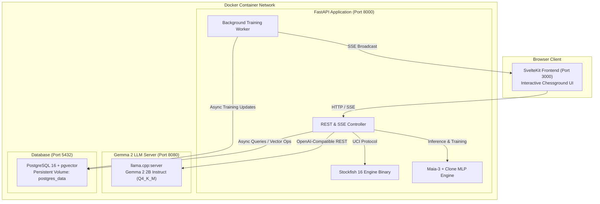
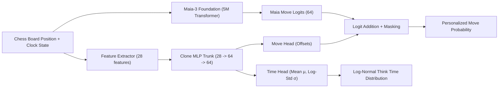

# takeback - Helping you replay your chess games through creating your chess clone.

**Made by Sai, Saaketh and Ragul for GatorHacks V!**

---

## Inspiration
Ever played a chess game where you're playing beautifully, then BAM! You've blundered, you lose, and you know exactly what you could have done instead to keep your momentum. Introducing **takeback**, a tool that allows users to replay their past games with an AI clone of themselves acting as their opponent.

## What it does
**takeback** focuses on simulating how real players play, through their tendencies and pacing. An AI clone of you plays as your opponent, allowing you to replay your moves within the game. Users can analyze their past games move by move, with game commentary from Gemma in 'analyze' mode. takeback allows users to sign in with their chess.com usernames, connecting their gameplay data to the application. From there, our clone model trains against Maia's move probability of the users' games, and scores the likelihood of the moves the user plays, taking into account their tendencies, pacing, consistent tactics, and other components of their game to imbibe their style. Soon after users put in their chess.com username to takeback, they have a trained clone model they can play against, analyzing their mistakes and improving their gameplay.

## How we built it
takeback was built with chess players of all skill levels in mind. We wanted to curate the experience for in-game analysis in a clean easy-to-use UI that is supported by cutting edge tech through the Maia version 3 chess model and our own custom-built MLP model for extracting user tendencies and pacing to build their clone. The model works by training on snapshots of each move in a game, understanding the board and player positions, the time players take for their moves, and likely next moves, training on the moves the user makes. Over hundreds of games, the model imbibes the player's tendencies and chess persona. 

The application was built using TypeScript and SvelteKit for clean, efficient reactive frontend development, a PostgreSQL database with `pgvector` for board embedding storage, a FastAPI backend with PyTorch CPU & Stockfish 16, and a local `llama.cpp:server` running Gemma 2 2B for commentary. Docker was used to allow anybody to run our entire open-source stack with just one command.

## Challenges we ran into
Our main challenge was ensuring our clone model could really help chess players in analyzing their blunders. We weighed the pros and cons of using different model architectures, such as LoRA models or having averaged outputs from a random forest model, before finally deciding on the MLP adapter for our chess clone. Integrating our model to the application, specifically the backend required rigorous testing and improvements before the user could smoothly analyze their performance by playing their clone.

## Accomplishments that we're proud of
We are proud of creating the clone that outperforms the baseline Maia model with an accuracy of around 60%. Our application also supports the game data of many users, storing games of different types, including rapid and blitz games. takeback's analysis mode came out how we envisioned it, allowing the user to see in real time the right moves they could have made to win, along with the reasoning of their clone opponent all supported by Gemma's commentary.

## What we learned
You can create a chess clone! We learned how an MLP model works in the context of our problem, how to create efficient model architectures, and how to think about defining an ML pipeline and system. Our team also learned about various processes of building an end-to-end AI application, through parsing PGNs from chess.com, to integrating an AI model that could do more than just a simple chatbot.

## What's next for takeback
We want to bring our application to more users, chess players of all skill levels. We aim to grow and scale our application to handle hundreds of games for hundreds of users, streamlining our model training, and data pipelines while ensuring our application remains working for a high load.

---

## 🏛️ Software Infrastructure Overview

The system is built as a modular microservice architecture orchestrated via **Docker Compose**:



### Infrastructure Services

| Service | Technology | Port | Description |
| :--- | :--- | :--- | :--- |
| **`frontend`** | **SvelteKit 2 + Vite + TailwindCSS** | `3000` | Reactive chess interface featuring interactive board (`chessground`), move annotation timeline, clone challenge arena, and game analysis reports. |
| **`backend`** | **FastAPI + PyTorch CPU + Stockfish 16** | `8000` | REST API handling JWT authentication, PGN parsing, real-time Maia-3 inference, clone MLP personalization, and background SSE training queues. |
| **`gemma`** | **llama.cpp:server (Gemma 2 2B IT)** | `8080` | High-efficiency local CPU LLM runner serving `gemma-2-2b-it-Q4_K_M.gguf` via an OpenAI-compatible REST endpoint for human-like game commentary. |
| **`db`** | **PostgreSQL 16 Alpine + pgvector** | `5432` | Relational storage for users, games, individual plies, and model metadata, equipped with `pgvector` for board embedding search and composite b-tree indexes for zero-latency pagination. |

---

## 🧠 Machine Learning Architecture

The AI clone combines a foundation chess policy with a personalized neural adapter:



1. **Maia-3 Foundation Transformer (5M parameters)**: Provides human-like move probabilities learned from millions of online human games across diverse ratings.
2. **Personalized Clone MLP**:
   - **Trunk**: Multi-layer perceptron (input: 28 hand-crafted tactical & context features $\to$ 64 $\to$ 64 with ReLU activations).
   - **Move Head**: Outputs 64 move offset values added directly to Maia-3's logit distribution. Initialized to zero so unadapted models exactly match Maia-3.
   - **Think Time Head**: 2-parameter output $(\mu, \log \sigma)$ modeling move duration as a **Log-Normal distribution** $\text{LogNormal}(\mu, \sigma^2)$ conditioned on position complexity, remaining clock, opponent think time, and ply number.
3. **Joint Loss Objective**:
   $$\mathcal{L} = \mathcal{L}_{\text{CE}}(\text{move}) + 0.2 \cdot \mathcal{L}_{\text{NLL}}(\text{think time})$$

---

## 🚀 How to Run the App with Docker

### Prerequisites
- [Docker](https://docs.docker.com/get-docker/) (v24.0 or later)
- [Docker Compose](https://docs.docker.com/compose/) (v2.20 or later)

### Step 1: Navigate to the Application Directory
```bash
cd revised
```

### Step 2: (Optional) Configure Environment
The project comes pre-configured with sensible defaults. To customize secrets or credentials:
```bash
cp .env.example .env
```

### Step 3: Build and Launch Containers
Run the Docker Compose stack in detached mode:
```bash
docker compose up --build -d
```
> [!NOTE]
> On the first run, Docker will download the necessary base images, fetch the **Gemma 2 2B** GGUF weights, and download the **Maia-3 (5M)** model into `./models`. Stockfish 16 is pre-installed automatically inside the backend image.

### Step 4: Verify Service Health
Check that all 4 containers are running and healthy:
```bash
docker compose ps
```

You can inspect logs at any time:
```bash
docker compose logs -f backend
```

### Step 5: Access the Interfaces
- **Web Application**: Open [http://localhost:3000](http://localhost:3000)
- **FastAPI Documentation (Swagger UI)**: [http://localhost:8000/docs](http://localhost:8000/docs)
- **Gemma LLM Server**: [http://localhost:8080/v1/models](http://localhost:8080/v1/models)
- **PostgreSQL Database**: `localhost:5432` (`user: chess_user`, `password: chess_password`, `database: chess_db`)

### Step 6: Stopping the Application
To stop all containers cleanly:
```bash
docker compose down
```
To stop and remove stored database volumes:
```bash
docker compose down -v
```

---

## 🧪 Reproducing Models & Standalone CLI

To train or reproduce the clone model directly outside of Docker:

### 1. Setup Virtual Environment
```bash
python3 -m venv .venv
source .venv/bin/activate
pip install -r revised/backend/requirements.txt
```

### 2. Train and Play Against a Clone
Run the standalone reproduction script:
```bash
python FINAL_MODEL/run.py stuffyness
```
This pipeline automatically:
1. Loads player games (or fetches recent games via the Chess.com public API).
2. Generates game snapshots with clock calculations and legal move masking.
3. Computes 28-dimensional context features and Maia-3 foundation logits.
4. Trains the personalized Clone MLP adapter using early stopping on validation move loss.
5. Launches an interactive terminal chess game against the newly trained clone!

### 3. Run Unit and Verification Tests
```bash
PYTHONPATH=. pytest tests/
```
All 9 unit and pipeline verification tests (zero-offset exact match, 28-feature dimension, split integrity, clock arithmetic, and backend analysis module) will execute and validate.

---

## 📁 Repository Structure

```text
├── revised/                  # Complete containerized application
│   ├── docker-compose.yml    # Orchestrates db, gemma, backend, frontend
│   ├── .env / .env.example   # Environment configuration
│   ├── database/init.sql     # PostgreSQL 16 DDL with pgvector
│   ├── backend/              # FastAPI application (Python 3.11, PyTorch, Stockfish)
│   └── frontend/             # SvelteKit reactive UI
├── FINAL_MODEL/              # Canonical model training & evaluation pipeline
│   ├── run.py                # End-to-end model training & play CLI
│   ├── implementation.py     # Clone MLP architecture & training loops
│   ├── features.py           # 28-feature contextual extractor
│   ├── snapshots.py          # Clock & ply snapshot builder
│   ├── maia_extractor.py     # Maia-3 batch feature extractor
│   ├── play_clone.py         # Interactive UCI clone engine
│   └── chess_pgn_parser.py   # Chess.com PGN ingest
├── maia3/                    # Maia-3 PyTorch transformer foundation
├── models/                   # Local model weights directory (maia3-5m.pt)
├── snapshots_dataset.pt      # Precomputed 18,000-snapshot tensor dataset
├── model_analysis/           # Empirical evaluation figures, infographics, and reports
├── analysis/                 # Host-side analysis module for querying DB & API
└── tests/                    # Unit tests and PRD verification suite
```
